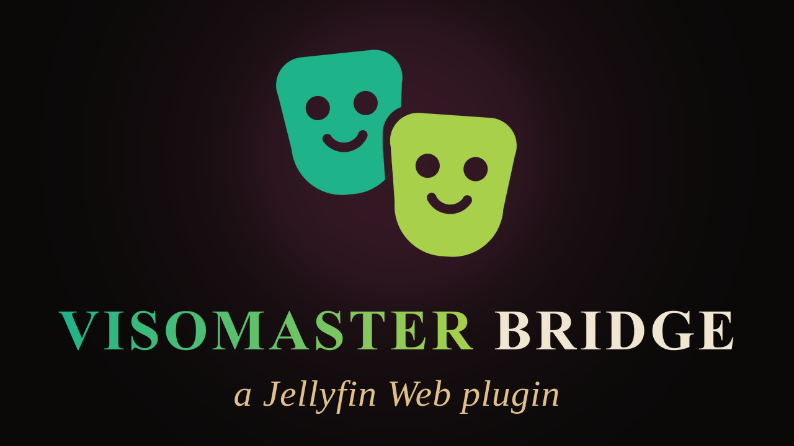
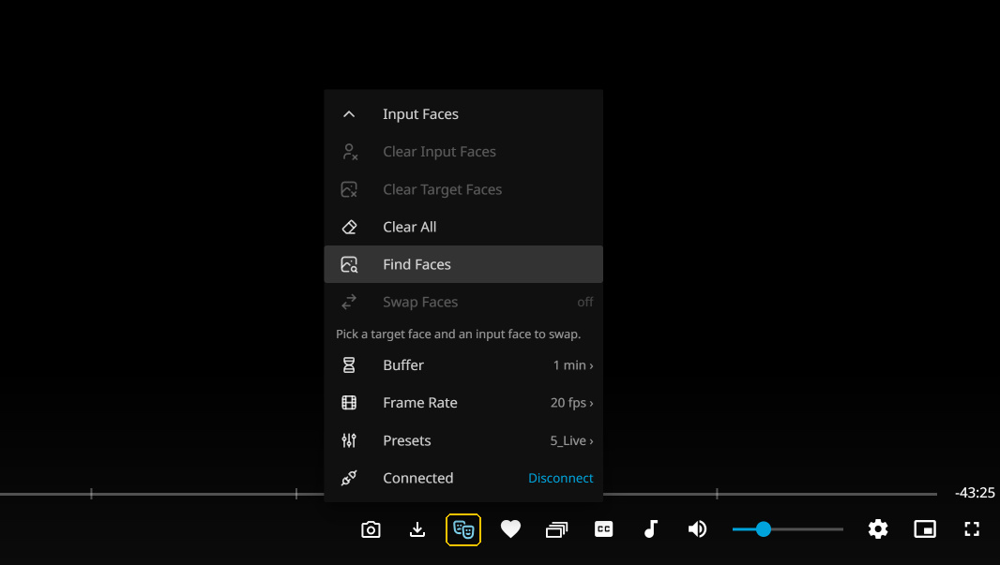

[Jellyfin Projects](https://linktr.ee/JellyfinProjects) | [Kodi Projects](https://linktr.ee/KodiProjects)

---



*Not affiliated with or endorsed by Jellyfin.*

---

**Alpha.** VisoMaster Bridge is an early public version. It works, but expect rough edges, and settings or behaviour may still change. How smoothly a film plays with swapped faces depends entirely on your graphics card. Feedback and bug reports are very welcome.

---

[VisoMaster Fusion](https://github.com/VisoMasterFusion/VisoMaster-Fusion) is a face swap program: it finds the faces in a picture or a video and replaces them with the faces you give it. I wanted that inside Jellyfin. Not as a second program next to my films, but in Jellyfin's own video player, switched on and off while the film is running.

So I built VisoMaster Bridge. It connects Jellyfin's video player to VisoMaster Fusion: you find the faces in the film, pick the faces you want instead, and switch the swap on. The film keeps playing in Jellyfin, with Jellyfin's sound, and only the picture comes from VisoMaster Fusion.

I have developed many Jellyfin Web script mods over the years, but besides this one, only four other true plugins: [ArtworkPlus](https://github.com/chrissix666/Jellyfin-ArtworkPlus), which shows the artwork Jellyfin leaves unused, [Cinema Project](https://github.com/chrissix666/Jellyfin-Cinema-Project), a virtual cinema environment based on three.js that gives your movies an ambient feel, [VideoOSD Tweaks and Candy](https://github.com/chrissix666/Jellyfin-VideoOSD-Tweaks-Candy), which puts you in full control of the Jellyfin video player OSD, and [Destroy](https://github.com/chrissix666/Jellyfin-Destroy), which turns the Jellyfin page you are looking at into a game level.

---

# Jellyfin VisoMaster Bridge

- [What This Is](#what-this-is)
- [What This Is Not](#what-this-is-not)
- [Under the Hood](#under-the-hood)
  - [Architecture](#architecture)
  - [Picture and Sound](#picture-and-sound)
- [Usage](#usage)
  - [The Menu](#the-menu)
  - [Input Faces](#input-faces)
  - [Buffer, Frame Rate and Presets](#buffer-frame-rate-and-presets)
- [Settings](#settings)
- [Requirements](#requirements)
- [Installation](#installation)
- [Developed For & Tested On](#developed-for--tested-on)
- [Credits](#credits)
- [License](#license)

---

**VisoMaster Bridge swaps faces in the film you are watching in Jellyfin. One button in the video player finds the faces on screen, lets you pick the faces you want instead, and switches VisoMaster Fusion's swapped picture on and off while the film keeps playing.**

---

## What This Is

A Jellyfin plugin with a button in the video player. When a face is on screen, press **Find Faces**, pick one of your input faces for it, press **Swap Faces**, and the film goes on with the new face.

Everything happens in the player: the faces, the input faces, the swap, the presets. You do not have to open VisoMaster Fusion to use it, the plugin runs VisoMaster Fusion's face pipeline in the background on its own.

The swap uses VisoMaster Fusion's own code and settings, so the result looks the same as in VisoMaster Fusion with the same faces and the same preset.

---

## What This Is Not

VisoMaster Bridge does not change your films. The film files, their pictures and their sound stay exactly as they are, nothing is written into the library, and nothing is saved when you close the player.

It is not a face swap program of its own. It needs [VisoMaster Fusion](https://github.com/VisoMasterFusion/VisoMaster-Fusion), installed separately, and it does not contain or ship any part of it.

It does not touch the sound. The sound always comes from Jellyfin, only the picture is swapped.

---

## Under the Hood

### Architecture

VisoMaster Bridge has three parts.

The server part is written in **C#**. It adds one script tag to Jellyfin Web's `index.html`, through the File Transformation plugin when it is installed, otherwise written into `index.html` directly (and removed again on uninstall). It serves the player script, stores the admin settings in the Jellyfin backend, and starts and stops the worker.

The worker is written in **Python** and runs on VisoMaster Fusion's own portable Python. It loads VisoMaster Fusion's models once, finds and recognises the faces, and swaps every frame of the film with VisoMaster Fusion's own frame pipeline. It listens on `127.0.0.1` only, every request carries a token, and it never writes into the VisoMaster Fusion folder. It starts with the first **Connect** and stops when nobody is connected anymore, or after the idle time set on the admin page.

The player part is **JavaScript**. It adds the button and its menu to Jellyfin's video player and lays a second video over Jellyfin's own picture: the swapped picture, streamed from the worker through the plugin.

---

### Picture and Sound

The worker reads the film file itself, starting at the position you are watching, swaps each frame and encodes the result as a video stream without sound. The browser plays that stream on top of Jellyfin's picture, held frame by frame to Jellyfin's clock. Pause, seek or change the speed, and the swapped picture follows.

When the graphics card cannot swap as fast as the film runs, the film plays slower instead of skipping, and the sound slows down with it, so picture and sound always stay together. The **Buffer** decides how much swapped picture is prepared ahead before the film goes on.

Films with non-square pixels, such as DVDs, keep their shape. NVENC is used for encoding when the graphics card offers it, otherwise the CPU.

---

## Usage

### The Menu

The VisoMaster button sits in the bottom bar of the video player. It opens a menu that grows upward from the button, read from the bottom:

- **Connect:** starts the worker and loads VisoMaster Fusion. The first start takes a while. **Disconnect** ends your swap; when nobody is connected anymore, the worker stops and frees the graphics card.
- **Presets:** VisoMaster Fusion's own presets, see below
- **Frame Rate** and **Buffer:** see below
- **Swap Faces:** switches the swapped picture on and off. It needs at least one target face with an input face.
- **Find Faces:** finds every face in the current picture and adds one tile per person. A person already found is not added again.
- **Clear All**, **Clear Target Faces**, **Clear Input Faces:** remove all faces, the selected target face, or the input faces of the selected target face
- **Input Faces:** opens the input faces for the selected target face

Pick a target face tile, open **Input Faces**, pick one or more input faces, and switch **Swap Faces** on. Several input faces for one target face are merged into one, just like in VisoMaster Fusion.

Nothing is stored. Faces, choices and presets last as long as the player is open.



<sub>The VisoMaster button (framed) and its menu, connected, before a swap.</sub>

---

### Input Faces

The input faces come from the folder set on the admin page:

- **Photos directly in the folder** form one group, named after the folder
- **Every subfolder is one person:** its photos are that person's input faces, `folder.jpg` is only its cover picture
- **Ready-made embeddings:** a person folder with an `embedding.json`, or a `<Name>.json` with a `<Name>-thumb.jpg` beside it, in VisoMaster Fusion's own **Save Embeddings** format. One click assigns it, nothing has to be calculated. An embedding made for a different swap model is shown greyed out.

The folder is read again whenever you open it, so new or replaced photos show up right away.

---

### Buffer, Frame Rate and Presets

- **Buffer:** 5 seconds to 5 minutes of swapped picture prepared ahead. A longer buffer waits longer at the start and after a seek, but plays more evenly on a slower graphics card. A new buffer applies at once.
- **Frame Rate:** Original, 24, 20, 15 or 12 fps for the swapped picture. A lower frame rate swaps fewer frames and keeps the film closer to its normal speed. The film and its sound keep their frame rate. VisoMaster Fusion's own maximum output FPS is the starting choice.
- **Presets:** VisoMaster Fusion's presets. **VisoMaster (current)** uses exactly the settings VisoMaster Fusion has right now. A preset applies to every face, also to faces found later.

Buffer and frame rate are remembered in the browser.

---

## Settings

Under **Dashboard → Plugins → VisoMaster Bridge**. They apply to every user.

- **Enable VisoMaster:** shows the button in the video player. Off hides it and stops the worker.
- **VisoMaster Path:** the folder of the portable VisoMaster Fusion install, the one that holds `portable-files` and `VisoMaster-Fusion`
- **Input Faces Folder:** the folder with the input faces. Without it no input faces can be picked.
- **Input Faces Visible To:** Everyone or Administrators
- **Button Position:** left of Favorite, Subtitles or Audio
- **Hide on Narrow Window:** hides the button below a 50em window width, matching Jellyfin's own vanilla behavior
- **Worker Port:** the local port of the worker, `8766` by default
- **Stop Worker After:** minutes without use after which the worker stops
- **Backup / restore via code:** all settings as one code

---

## Requirements

- **Windows**, with the Jellyfin server and VisoMaster Fusion on the **same computer**: the worker runs there and reads the film files from the server's disks
- **[VisoMaster Fusion](https://github.com/VisoMasterFusion/VisoMaster-Fusion)**, installed with its **portable launcher** (`Start_Portable.bat`), which brings its own Python, FFmpeg and models. Start it once and let it download its models before you use the plugin.
- **An NVIDIA graphics card** with an up-to-date driver. The worker runs VisoMaster Fusion's models with CUDA. How fast the swap is depends on the card, the film's resolution, the number of faces and the preset.
- **Jellyfin Web in a desktop browser**

It also runs in the apps that load the server's own Jellyfin Web page, such as Jellyfin Desktop. These are not tested. It does **not** run in the native Jellyfin apps for Android, iOS, Android TV, webOS or other TV platforms, since none of those run the server's Jellyfin Web page.

[VideoOSD Tweaks and Candy](https://github.com/chrissix666/Jellyfin-VideoOSD-Tweaks-Candy) is optional. When it is installed, it sorts the VisoMaster button together with its own buttons, and the Button Position setting is left to it.

---

## Installation

1. Install [VisoMaster Fusion](https://github.com/VisoMasterFusion/VisoMaster-Fusion) with its portable launcher, start it once and let it finish downloading its models.
2. In Jellyfin, go to **Dashboard → Plugins → Repositories → Add Repository** and add:

```
https://raw.githubusercontent.com/chrissix666/Jellyfin-VisoMaster-Bridge/main/manifest.json
```

3. Go to **Catalog**, find **VisoMaster Bridge**, install it, and restart the Jellyfin server. Jellyfin picks the build that matches your server on its own: 1.x for 10.10.7, 2.x for 12.0+.
4. Under **Dashboard → Plugins → VisoMaster Bridge**, set **VisoMaster Path** and **Input Faces Folder**, and save.
5. Reload Jellyfin Web and play a film. The VisoMaster button appears in the video player.

The [File Transformation](https://github.com/IAmParadox27/jellyfin-plugin-file-transformation) plugin is recommended. Without it, VisoMaster Bridge writes its script tag into Jellyfin Web's `index.html` itself. Where Jellyfin's web folder is read-only, that is not possible, and VisoMaster Bridge needs File Transformation to start.

---

## Developed For & Tested On

- Designed and written for Jellyfin Web 10.10.7 and 12.0+
- Google Chrome
- Windows 11

Other versions may work but are not tested and could lead to unexpected behavior.

---

## Credits

- [VisoMaster Fusion](https://github.com/VisoMasterFusion/VisoMaster-Fusion), which does the actual face swap, built on the original VisoMaster by [argenspin](https://github.com/argenspin) and [Alucard24](https://github.com/alucard24). VisoMaster Fusion is a separate program under the GPL-3.0 license, installed by you. VisoMaster Bridge does not contain or ship any of its code or models.
- Icons: [Tabler Icons](https://tabler.io/icons) (MIT), the license is included as `LICENSE-tabler-icons.txt`

---

## License

MIT License

Forking and further development strongly encouraged.
Feedback and bug reports welcome, feel free to open an issue.

---
